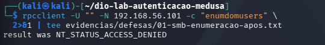

# Laboratório de autenticação com Medusa: FTP, DVWA e SMB

Montei este laboratório como parte do desafio de cibersegurança da DIO/Santander. Usei o Kali Linux para testar autenticação em uma VM Metasploitable 2 e acompanhar, nos logs do servidor, o que acontecia em cada tentativa.

Comecei com credenciais padrão e listas pequenas. Depois, comparei os níveis Low, Medium e High do DVWA, investiguei um resultado de SMB que parecia indicar acesso administrativo e apliquei mudanças nas senhas e na configuração do Samba. O projeto reúne os comandos, os resultados e os retestes dessas alterações.

## Principais resultados

No **FTP**, a senha padrão foi aceita na quinta entrada da lista. Depois da troca, nenhuma das cinco senhas antigas funcionou, enquanto a nova credencial foi aceita.

No **DVWA 1.0.7**, a lista encontrou a senha válida nos três níveis. O High acrescentou uma espera de três segundos após cada falha, e o lote levou 12,12 segundos. Os logs também mostraram outro problema: as senhas enviadas pelo formulário apareciam na URL das requisições.

O **SMB** exigiu mais investigação. Consegui enumerar 35 usuários sem autenticação e testar uma senha em três contas. O Medusa indicou sucesso para `msfadmin`, mas a listagem de `ADMIN$` foi negada. Os logs confirmaram autenticação; acesso administrativo não foi demonstrado. Após alterar a configuração do Samba, a mesma consulta anônima passou a retornar acesso negado.



## Ambiente

Usei duas VMs próprias no VirtualBox, configuradas em rede host-only: Kali em `192.168.56.102` e Metasploitable em `192.168.56.101`. As ferramentas principais foram Nmap 7.99 e Medusa 2.3. Os testes ficaram restritos a FTP, HTTP/DVWA e SMB nesse ambiente deliberadamente vulnerável.

Veja a [topologia do laboratório](docs/01-ambiente.md#topologia-do-laboratório), com as VMs, a rede host-only, os serviços testados e os logs utilizados na validação.

## Documentação

1. [Ambiente, topologia e reconhecimento](docs/01-ambiente.md)
2. [Metodologia e limites dos testes](docs/02-metodologia.md)
3. [FTP: autenticação e teste com lista](docs/03-ftp.md)
4. [DVWA: comparação dos três níveis](docs/04-dvwa.md)
5. [SMB: enumeração e investigação dos resultados](docs/05-smb.md)
6. [Defesas aplicadas e recomendações](docs/06-defesas.md)
7. [Índice das evidências](docs/07-evidencias.md)
8. [Conclusões](docs/08-conclusoes.md)
9. [Referências](docs/09-referencias.md)

Os capítulos incluem relações com CWE para contextualizar os achados. As recomendações distinguem o que foi aplicado no laboratório das melhorias propostas para um ambiente real.

## Arquivos do projeto

Os logs estão em `evidencias/`, os 66 prints em `images/` e as listas utilizadas em `wordlists/`. Cookies e novas senhas foram ocultados nas evidências públicas. O [índice](docs/07-evidencias.md) explica a organização e as exclusões feitas antes da publicação.

Para conferir os arquivos de uma cópia baixada, execute na raiz do projeto:

```bash
python3 scripts/verificar_integridade.py
```

O script compara os arquivos com `SHA256SUMS`; foi acrescentado na organização da documentação. As orientações para manter o repositório estão em [PUBLICACAO.md](PUBLICACAO.md).

**Autor:** Vinicius · **Execução:** outubro de 2026.
