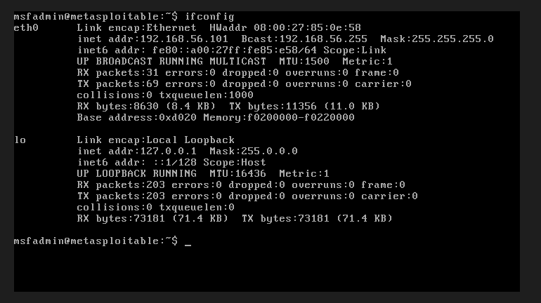
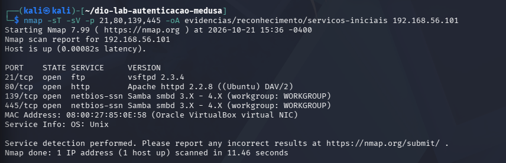

# Ambiente e reconhecimento

[Início](../README.md) · [Próximo: metodologia](02-metodologia.md)

## Montagem do laboratório

Usei o VirtualBox no Windows para executar o Kali Linux e o Metasploitable 2. Configurei as duas VMs em host-only para trabalhar com os serviços do alvo em uma rede de laboratório.

| Máquina | Endereço | Função |
| --- | --- | --- |
| Kali Linux | `192.168.56.102/24` | Executar Nmap, Medusa, clientes FTP/SMB e navegador |
| Metasploitable 2 | `192.168.56.101/24` | Disponibilizar FTP, DVWA e Samba e registrar os eventos |

O [inventário do Kali](../evidencias/ambiente/inventario-kali.txt) mostra a rede conectada `192.168.56.0/24`, sem rota padrão naquele registro. Não incluí capturas das telas de configuração dos adaptadores; o inventário documenta os endereços e as rotas observados, mas não substitui uma verificação completa do isolamento no hipervisor.



## Ferramentas e serviços

O inventário registra Kali 2026.2 Rolling, Nmap 7.99 e Medusa 2.3. Os módulos usados no Medusa eram `ftp` 2.1, `web-form` 2.1 e `smbnt` 3.0.

| Serviço | Versão identificada | Fonte |
| --- | --- | --- |
| FTP | vsftpd 2.3.4 | Banner e Nmap |
| HTTP | Apache 2.2.8, Ubuntu, DAV/2 | Nmap |
| SMB | Samba 3.0.20-Debian | [Log de inicialização](../evidencias/servidor/extraidos/smb-log-smbd.txt) |
| Aplicação web | DVWA 1.0.7 | Rodapé das telas |

O Nmap identificou o Samba apenas como `3.X - 4.X`. Para registrar a versão específica, consultei o log do servidor. Essa diferença é relevante ao pesquisar documentação e vulnerabilidades de versões antigas.

## Reconhecimento

A verificação de conectividade teve quatro respostas em quatro pacotes. Em seguida, no Kali, examinei somente as portas dos serviços escolhidos:

```bash
nmap -sT -sV -p 21,80,139,445 \
  -oA evidencias/reconhecimento/servicos-iniciais 192.168.56.101
```

As portas TCP 21, 80, 139 e 445 estavam abertas, correspondendo a FTP, HTTP e SMB. Salvei a saída em [texto](../evidencias/reconhecimento/servicos-iniciais.nmap), [XML](../evidencias/reconhecimento/servicos-iniciais.xml) e [formato grepable](../evidencias/reconhecimento/servicos-iniciais.gnmap). O teste de conectividade está em [conectividade.txt](../evidencias/reconhecimento/conectividade.txt).



## Preparação para repetir os testes

Os comandos dos capítulos usam a raiz do projeto no Kali como diretório de trabalho. As pastas necessárias podem ser criadas com:

```bash
mkdir -p docs wordlists scripts evidencias/{ambiente,reconhecimento,ftp,dvwa,smb,defesas}
```

As listas estão em `wordlists/`. Em uma nova execução, use outra pasta para as saídas: `tee` sem `-a` substitui o arquivo existente. Crie também um snapshot antes de alterar credenciais ou configurações e exporte os registros antes de restaurá-lo. As capturas de snapshots não fazem parte deste repositório.

Para comparar o DVWA, confira a versão e o código instalado. O comportamento descrito aqui é o da versão 1.0.7; uma instalação atual pode ter mecanismos diferentes.

## Diferença entre os relógios

Após retomar as VMs, percebi que os horários não coincidiam. As capturas mostram Kali em **22/10/2026, 10:27:16 EDT** e Metasploitable em **21/10/2026, 22:39:46 EDT**. As leituras foram feitas em momentos diferentes, mas mostram uma divergência de aproximadamente 11 h 47 min. Os registros das VMs usam EDT/`-0400`, diferente do meu fuso no Brasil.

Mantive os horários originais e comparei origem, conta, sequência e intervalos entre eventos. Não usei a subtração de timestamps de máquinas diferentes para medir a duração dos testes. Os [prints do Kali](../images/smb-15-relogio-kali.png) e do [Metasploitable](../images/smb-16-relogio-metasploitable.png) registram essa conferência. Em uma próxima execução, a sincronização dos relógios deve ocorrer antes da coleta.
