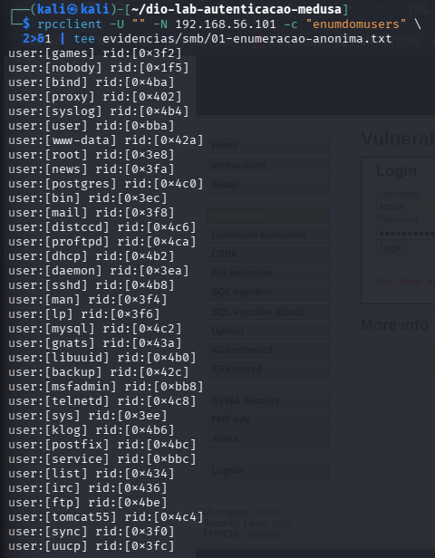
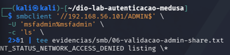

# SMB: enumeração, spraying e investigação

[Início](../README.md) · [Anterior: DVWA](04-dvwa.md) · [Próximo: defesas](06-defesas.md)

No SMB, comecei verificando se o servidor expunha nomes de contas sem autenticação. Depois testei uma senha conhecida em três usuários. A indicação de sucesso do Medusa levou a uma investigação adicional: era necessário conferir quais operações a conta realmente conseguia executar.

## Enumeração inicial

No Kali, o comando abaixo retornou 35 usuários:

```bash
rpcclient -U "" -N 192.168.56.101 -c 'enumdomusers'
```

O resultado está em [01-enumeracao-anonima.txt](../evidencias/smb/01-enumeracao-anonima.txt). A lista forneceu nomes que poderiam orientar tentativas de autenticação, embora a presença de uma conta não garanta que ela aceite login.

Uma consulta da política de senhas retornou `min_password_length: 0` e `password_properties: 0x00000000`, conforme [02-politica-senhas.txt](../evidencias/smb/02-politica-senhas.txt). Esses campos documentam uma configuração permissiva, mas não provam que existam senhas vazias nem descrevem, sozinhos, toda a política de bloqueio do ambiente.



## Controle negativo e password spraying

A ajuda local do módulo foi preservada em [03-ajuda-smbnt.txt](../evidencias/smb/03-ajuda-smbnt.txt). O teste usou conta local e senha em texto como entrada do módulo:

```bash
medusa -h 192.168.56.101 -u msfadmin -p senha-incorreta-dio \
  -M smbnt -m GROUP:LOCAL -m PASS:PASSWORD -t 1 -v 6
```

O [controle negativo](../evidencias/smb/04-controle-negativo.txt) não apresentou `ACCOUNT FOUND`. Em seguida, uma única senha conhecida do laboratório foi testada em três contas, listadas em [smb-usuarios.txt](../wordlists/smb-usuarios.txt): `user`, `service` e `msfadmin`.

```bash
medusa -h 192.168.56.101 -U wordlists/smb-usuarios.txt -p msfadmin \
  -M smbnt -m GROUP:LOCAL -m PASS:PASSWORD -t 1 -v 6
```

| Conta | Senha utilizada | Resultado registrado |
| --- | --- | --- |
| `user` | `msfadmin` | Sem indicação de sucesso |
| `service` | `msfadmin` | Sem indicação de sucesso |
| `msfadmin` | `msfadmin` | `ACCOUNT FOUND` e `SUCCESS` |

A [execução](../evidencias/smb/05-password-spraying.txt) demonstrou spraying em três contas. A senha padrão aceita por `msfadmin` se relaciona à [CWE-1393](https://cwe.mitre.org/data/definitions/1393.html), assim como no FTP.

## Por que o resultado sobre ADMIN$ exigiu investigação

O módulo exibiu `SUCCESS (ADMIN$ - Access Allowed)`. Para verificar o alcance dessa mensagem, foi feita uma tentativa independente de listagem:

```bash
smbclient '//192.168.56.101/ADMIN$' -U 'msfadmin%msfadmin' -c ls
```

A resposta foi `NT_STATUS_NETWORK_ACCESS_DENIED listing \\*`, conforme [06-validacao-admin-share.txt](../evidencias/smb/06-validacao-admin-share.txt). Uma segunda consulta também não estabeleceu identidade e permissões de forma conclusiva:

```bash
rpcclient -U 'msfadmin%msfadmin' 192.168.56.101 \
  -c 'getusername; netsharegetinfo ADMIN$'
```

O registro contém `BAD SIG` e `ACCESS_DENIED`; veja [07-identidade-compartilhamento.txt](../evidencias/smb/07-identidade-compartilhamento.txt). A causa específica desse erro não foi isolada. Não há base para atribuí-lo exclusivamente à senha, à assinatura SMB ou a uma incompatibilidade específica.

**Conclusão:** a credencial autenticou, mas não foi demonstrada listagem administrativa nem privilégio de administrador. O nome `ADMIN$` e a mensagem do módulo não substituem a validação de uma operação autorizada.



## Confirmação no servidor

Os primeiros logs não traziam detalhe suficiente para separar os resultados do teste. Consultei a configuração efetiva com `testparm -s` no Metasploitable e conferi os registros: Samba `3.0.20-Debian`, backend `tdbsam`, logs por máquina e nível inicial de depuração 1.

Para uma janela curta de diagnóstico, o nível foi aumentado:

```bash
sudo smbcontrol smbd debuglevel
sudo smbcontrol smbd debug 3
sudo smbcontrol smbd debuglevel
```

Foram repetidos no Kali um controle com senha incorreta e outro com a senha padrão. Os arquivos [12-debug-controle-negativo.txt](../evidencias/smb/12-debug-controle-negativo.txt) e [13-debug-controle-positivo.txt](../evidencias/smb/13-debug-controle-positivo.txt) registram essa nova rodada.

No Metasploitable, o resumo foi coletado por caminho absoluto; o diretório atual não era requisito:

```bash
sudo grep -i -B 1 -A 2 'authentication for user' /var/log/samba/log.* \
  | tee ~/smb-auth-resumo.txt
less ~/smb-auth-resumo.txt
```

| Evento | Kali, relógio local | Metasploitable, relógio local | Confirmação do servidor |
| --- | --- | --- | --- |
| Controle negativo | 22/10, 10:14:10 | 21/10, 22:26:56 | `NT_STATUS_WRONG_PASSWORD` |
| Controle positivo | 22/10, 10:15:08 | 21/10, 22:27:54 | Autenticação de `msfadmin` bem-sucedida |

Os dois pares têm intervalo de 58 segundos. A correspondência de conta, origem, sequência e intervalo sustenta a correlação mesmo com relógios diferentes. Não foi aplicada correção artificial aos arquivos. A discussão completa dos horários está no [ambiente](01-ambiente.md).

O [resumo de autenticação](../evidencias/servidor/extraidos/smb-auth-resumo.txt) confirma os dois resultados. O [log adicional](../evidencias/servidor/extraidos/smb-validacao-logs.txt) associa a sessão bem-sucedida a UID e GID 1000 e registra conexão a `ADMIN$` com caminho `/tmp`. Isso ajuda a interpretar a resposta do módulo, mas não transforma a conta em administrador. Entradas antigas de acesso anônimo presentes no mesmo recorte não foram atribuídas a esse controle.

Após a coleta, o nível foi restaurado:

```bash
sudo smbcontrol smbd debug 1
sudo smbcontrol smbd debuglevel
```

Os arquivos [antes](../evidencias/servidor/extraidos/smb-debug-antes.txt), [durante](../evidencias/servidor/extraidos/smb-debug-durante.txt) e [depois](../evidencias/servidor/extraidos/smb-debug-depois.txt) registram a transição de 1 para 3 e o retorno a 1. A depuração ampliada foi usada para diagnóstico, não como configuração permanente de proteção.

## Resultado da investigação

A confirmação do servidor resolveu a dúvida sobre a senha, mas a listagem de `ADMIN$` continuou negada e a causa do erro `BAD SIG` não foi isolada. Mantive esses registros porque delimitam o que foi demonstrado: autenticação da conta, sem comprovação de privilégio administrativo.

A mensagem `ENCRYPTED password` do módulo também precisa ser lida no seu contexto; ela não prova que todo o tráfego SMB estava criptografado. As mudanças na enumeração e na senha, com seus retestes, estão em [defesas](06-defesas.md).
