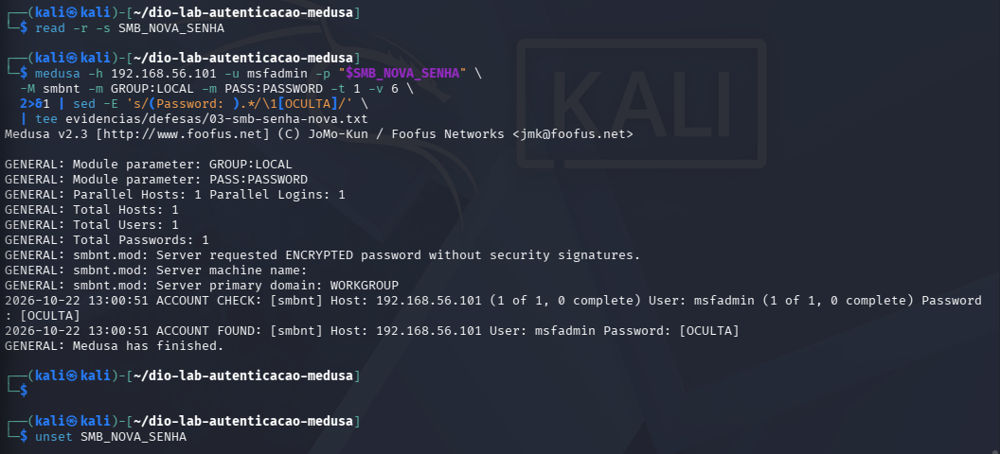

# Defesas aplicadas e recomendações

[Início](../README.md) · [Anterior: SMB](05-smb.md) · [Próximo: evidências](07-evidencias.md)

Depois dos testes iniciais, alterei a configuração de enumeração do Samba e substituí as senhas usadas no SMB e no FTP. Repeti as tentativas antigas e confirmei as novas credenciais para verificar o efeito das mudanças.

## 1. Restrição de enumeração no Samba

No Metasploitable, adicionei à seção `[global]` de `/etc/samba/smb.conf` a configuração:

```ini
[global]
    restrict anonymous = 1
```

O fragmento mostra somente a diretiva alterada; não é um arquivo completo para substituir a configuração existente. Após a edição, a sintaxe e a configuração efetiva foram verificadas e o serviço recebeu o pedido de recarga:

```bash
sudo testparm -s
sudo smbcontrol smbd reload-config
```

A [configuração coletada após a defesa](../evidencias/servidor/extraidos/smb-config-defesa.txt) e a [captura de validação](../images/defesa-smb-02-validacao.png) registram a diretiva. No Kali, foi repetida a mesma consulta anônima:

```bash
rpcclient -U "" -N 192.168.56.101 -c 'enumdomusers' 2>&1 \
  | tee evidencias/defesas/01-smb-enumeracao-apos.txt
```

A consulta que antes retornava 35 usuários passou a responder `NT_STATUS_ACCESS_DENIED`.

O resultado está em [01-smb-enumeracao-apos.txt](../evidencias/defesas/01-smb-enumeracao-apos.txt). O compartilhamento `tmp` ainda apresentava `guest ok = Yes` na configuração analisada. A mudança não demonstra remoção de todos os acessos de convidado nem proteção contra qualquer técnica de enumeração.

## 2. Substituição da senha SMB

No Metasploitable, a credencial do banco de senhas do Samba foi atualizada com entrada interativa:

```bash
sudo smbpasswd msfadmin
```

Mantive a nova senha oculta nas evidências públicas. No Kali, a tentativa com a senha antiga `msfadmin` não produziu `ACCOUNT FOUND`, como registrado em [02-smb-senha-antiga.txt](../evidencias/defesas/02-smb-senha-antiga.txt). Em seguida, a nova senha produziu essa indicação em [03-smb-senha-nova.txt](../evidencias/defesas/03-smb-senha-nova.txt).

Para reproduzir o controle positivo em um laboratório próprio, sem escrever a senha literalmente na linha do histórico:

```bash
read -r -s -p 'Nova senha SMB: ' SMB_NOVA_SENHA
printf '\n'
medusa -h 192.168.56.101 -u msfadmin -p "$SMB_NOVA_SENHA" \
  -M smbnt -m GROUP:LOCAL -m PASS:PASSWORD -t 1 -v 6 2>&1 \
  | sed -E 's/(Password: ).*/\1[OCULTA]/' \
  | tee evidencias/defesas/03-smb-senha-nova.txt
unset SMB_NOVA_SENHA
```

A entrada fica sem eco e a saída é filtrada antes da gravação. O alcance desse cuidado e o efeito do filtro sobre a linha de sucesso estão explicados na [metodologia](02-metodologia.md).



Neste reteste SMB, a evidência é a saída do cliente. Os logs detalhados do capítulo anterior pertencem à rodada de diagnóstico, anterior à troca da senha.

## 3. Substituição da senha utilizada pelo FTP

No Metasploitable, a senha da conta Linux `msfadmin` foi alterada com:

```bash
passwd
```

Essa mudança afeta a conta do sistema utilizada no teste FTP e pode afetar o acesso local e o uso de `sudo`. A alteração no banco do Samba foi uma operação separada; não se presumiu sincronização automática entre ambas.

No Kali, a lista inicial de cinco senhas foi reutilizada:

```bash
medusa -h 192.168.56.101 -u msfadmin -P wordlists/ftp-senhas.txt \
  -M ftp -t 1 -f -v 6 2>&1 \
  | tee evidencias/defesas/04-ftp-lista-apos.txt
```

Nenhuma entrada produziu sucesso. O [registro do reteste](../evidencias/defesas/04-ftp-lista-apos.txt) mostra as cinco verificações. Um controle com a nova senha confirmou que o serviço permanecia acessível e aceitava a credencial atual:

```bash
read -r -s -p 'Nova senha FTP: ' FTP_NOVA_SENHA
printf '\n'
medusa -h 192.168.56.101 -u msfadmin -p "$FTP_NOVA_SENHA" \
  -M ftp -t 1 -v 6 2>&1 \
  | sed -E 's/(Password: ).*/\1[OCULTA]/' \
  | tee evidencias/defesas/05-ftp-senha-nova.txt
unset FTP_NOVA_SENHA
```

O [controle positivo](../evidencias/defesas/05-ftp-senha-nova.txt) contém `ACCOUNT FOUND`. Aplicam-se as mesmas limitações do filtro e dos argumentos de processo descritas para SMB.

No servidor, o recorte foi coletado com:

```bash
sudo grep 'LOGIN' /var/log/vsftpd.log | tail -n 10 \
  | tee ~/ftp-defesa-log.txt
less ~/ftp-defesa-log.txt
```

O arquivo transferido ao Kali, [06-ftp-log-servidor.txt](../evidencias/defesas/06-ftp-log-servidor.txt), registra cinco `FAIL LOGIN`, entre 01:36:33 e 01:36:45 de 22/10 pelo relógio do servidor, e um `OK LOGIN` às 01:42:13. No Kali, as verificações da lista aparecem entre 13:23:54 e 13:24:05, com o controle positivo às 13:29:33. A sequência e os intervalos sustentam a correlação, sem exigir relógios sincronizados.

O mesmo recorte inclui eventos anteriores, inclusive acessos de transferência. Eles não foram contados como parte das cinco falhas do reteste.

## Síntese do antes e depois

| Verificação | Situação inicial | Após alteração |
| --- | --- | --- |
| Enumeração anônima de usuários SMB | 35 contas expostas pela consulta | Mesma consulta negada |
| SMB com senha padrão | Aceita | Sem sucesso no reteste |
| SMB com senha nova | Não se aplica à rodada inicial | Aceita no controle positivo |
| FTP com lista inicial | Sucesso na quinta entrada | Cinco entradas sem sucesso |
| FTP com senha nova | Não se aplica à rodada inicial | Aceita; confirmação no log do servidor |

## Recomendações para um ambiente real

As alterações acima foram executadas no laboratório. As recomendações a seguir ampliam o tratamento dos achados e **não foram implementadas nestas VMs**. Para cada problema, considero a correção técnica, a rotina administrativa que a sustenta e uma forma de conferir seu resultado.

### Senhas padrão e administração das contas

As credenciais aceitas no FTP, SMB e DVWA se relacionam à **CWE-1393**, uma especialização da CWE-1392 para senhas padrão. O risco é permitir que alguém autentique usando um valor conhecido, sem precisar descobrir uma senha exclusiva daquela instalação. A troca aplicada em FTP e SMB removeu os valores testados; a senha padrão do exercício DVWA foi mantida para o estudo.

Em um serviço real, a implantação deve exigir uma credencial exclusiva antes da liberação de acesso. A equipe responsável precisa manter um inventário das contas de serviço, definir seus responsáveis e retirar contas sem uso. Para acessos pessoais, contas individuais facilitam a atribuição de ações. A verificação de credenciais padrão deve fazer parte da aprovação de uma nova instalação.

O critério de aceite é confirmar que os valores padrão são rejeitados e que o acesso autorizado continua funcionando. O registro dessa verificação deve identificar conta, serviço, data e responsável, sem guardar a senha. O reteste realizado aqui atende a esse critério para as credenciais substituídas, mas não mede a força das novas senhas contra listas maiores.

### Tentativas sucessivas de autenticação no DVWA

O código observado e a continuidade das tentativas se relacionam à **CWE-307**. A espera do High aumentou o tempo do lote, mas não interrompeu a sequência. Como a amostra foi pequena, não atribuo esse mesmo diagnóstico a todas as políticas dos serviços FTP e SMB.

Para um sistema real, proponho limitação de tentativas associada à conta, com janela de observação e recuperação definidas. A origem das tentativas complementa a análise, especialmente em spraying, que distribui poucas tentativas entre contas diferentes. MFA pode acrescentar proteção quando o serviço oferece suporte. Bloqueios precisam ser avaliados também pelo risco de impedir o acesso de usuários legítimos.

Administrativamente, deve haver uma equipe responsável por receber os alertas e um procedimento para investigar sequências de falhas, apoiar a recuperação de conta e registrar o atendimento. Os valores de limite e duração devem ser escolhidos conforme o serviço, em vez de usar um número arbitrário para qualquer aplicação.

A validação precisa testar o limite configurado, a recuperação após o período previsto e o funcionamento de um login legítimo. Também deve conferir se uma senha distribuída por várias contas produz o alerta esperado. Esses testes ainda não foram realizados neste projeto.

### Enumeração e permissões SMB

A exposição de nomes de usuários facilitou a seleção das contas para o spraying. A configuração `restrict anonymous = 1` impediu a consulta usada no teste, mas `tmp` ainda apresentava `guest ok = Yes` na configuração analisada. Isso exige uma revisão própria de acessos de convidado e de permissões de leitura e escrita.

A medida técnica proposta é exigir autenticação onde o acesso anônimo não for necessário e limitar cada compartilhamento ao uso previsto. A medida administrativa é definir um responsável pelo compartilhamento, documentar quem precisa acessá-lo e revisar permissões quando houver mudança de função ou desligamento. Exceções de acesso anônimo devem ter finalidade e responsável conhecidos.

A conferência deve combinar consulta anônima, acesso de uma conta autorizada e tentativa de uma conta sem permissão. O teste realizado comprovou apenas a rejeição da consulta anônima `enumdomusers`; não avaliou toda essa matriz de permissões. O resultado de `ADMIN$` reforça a necessidade de testar operações concretas, como listar, ler e escrever, conforme o acesso esperado.

### Senhas em URLs e registros HTTP

Os logs do Apache mostram valores do parâmetro `password`, correspondendo à **CWE-598**. Em uma aplicação real, uma senha exposta nesses registros poderia ser usada por quem tivesse acesso a eles. O problema também pode alcançar histórico e referências de navegação.

A correção proposta é retirar a senha da query string e enviá-la no corpo da requisição, por um canal HTTPS. Trocar GET por POST sem retirar o segredo da URL não resolve a exposição. Também é necessário revisar o que a aplicação e seus intermediários registram, para que a senha não seja copiada do corpo para outro log.

A administração dos registros deve definir quem pode consultá-los, por quanto tempo são mantidos e como serão descartados. Se um segredo real for encontrado nos logs, deve-se restringir sua exposição, avaliar seu uso e providenciar sua substituição. A publicação de evidências precisa passar pela mesma revisão de segredos.

O critério de verificação é executar um login com uma senha de teste e conferir a URL e os registros dos componentes envolvidos. O valor não deve aparecer nesses locais, e a autenticação deve continuar funcionando. A mudança no formulário e esse reteste não foram realizados no laboratório.

### Manutenção e qualidade dos registros

O Metasploitable é deliberadamente vulnerável. Em um ambiente de produção, as versões antigas precisam ser substituídas por componentes suportados e configurados de acordo com o serviço necessário. O uso de MD5 visível no DVWA também exige revisão do armazenamento de senhas; a referência de armazenamento da OWASP apresenta alternativas adequadas, como Argon2id. Essa migração não foi testada aqui.

A manutenção precisa ter inventário de versões, responsável por atualização, teste de compatibilidade e procedimento de retorno em caso de falha. Para os logs, é necessário sincronizar relógios, registrar o fuso e limitar a depuração ampliada ao período de diagnóstico. Uma verificação simples é gerar um evento conhecido e confirmar que ele pode ser localizado e correlacionado nos componentes envolvidos.

As recomendações de autenticação, armazenamento e registro são apoiadas nas fontes da OWASP e do Samba listadas nas [referências](09-referencias.md). Nenhuma delas altera o status dos retestes já documentados: os controles implementados foram a restrição da consulta anônima e as trocas de senha.
